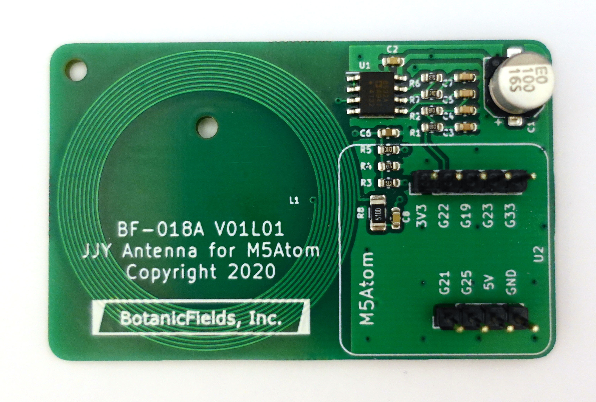
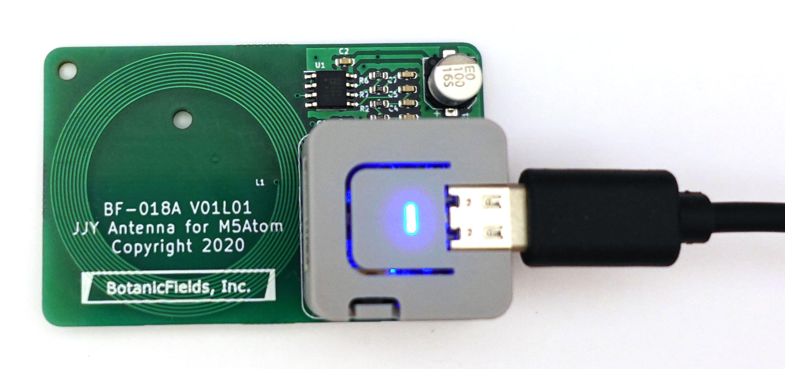
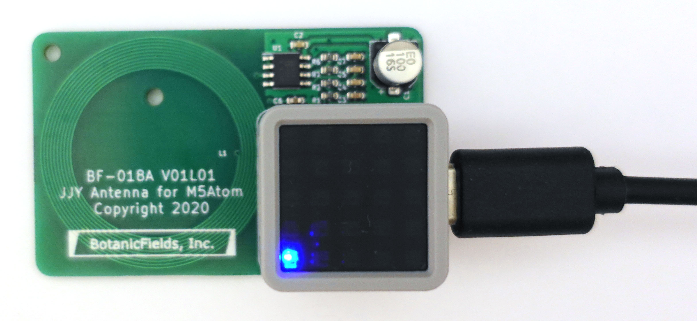
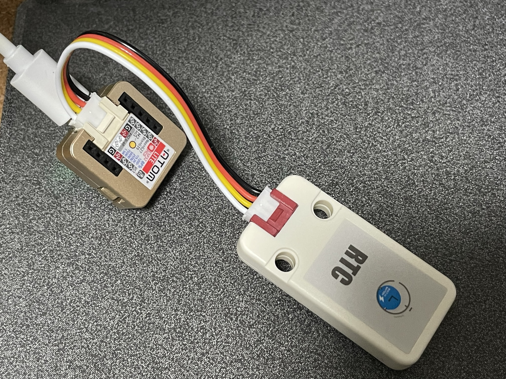
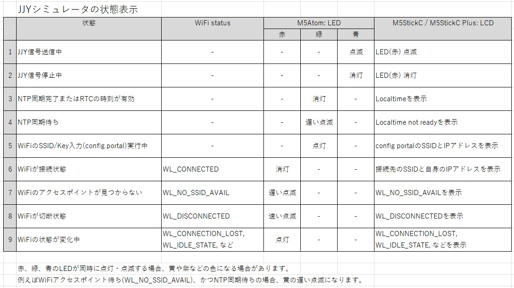
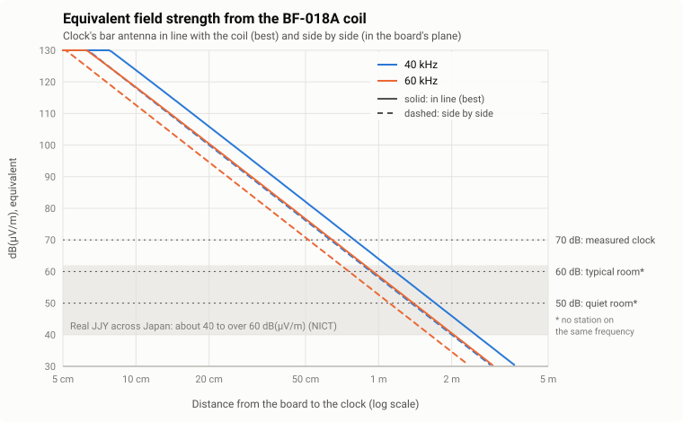
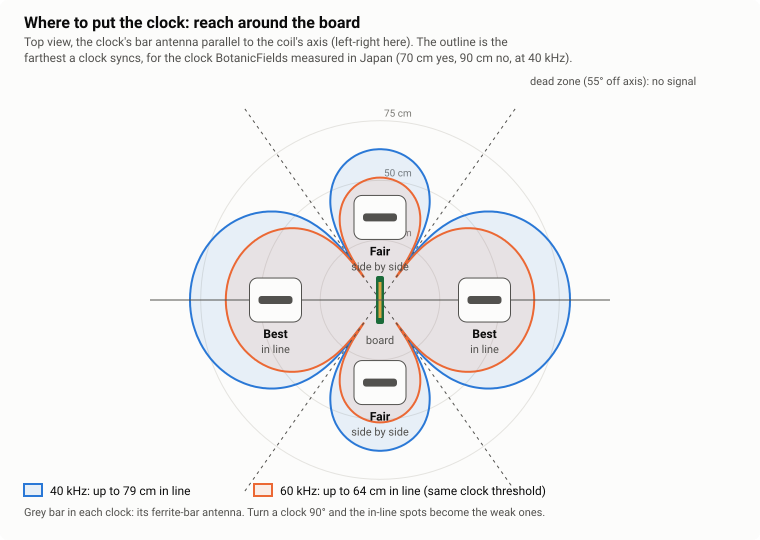

# JJY Simulator for M5Atom
## A JJY radio time signal simulator that runs on the ATOMS3 Lite and ATOM Lite/Matrix
Note: the standard ATOMS3 (the non-Lite model) is not supported.

### 2026-11-16 update
- Added an English translation of BotanicFields' Qiita article [Generating a simulated JJY time signal with Ticker on the M5StickC / M5Atom](https://qiita.com/BotanicFields/items/a78c80f947388caf0d36), which explains how this firmware makes the signal: https://tunlezah.github.io/JJYSim/jjy-ticker/ ([docs/jjy-ticker/index.html](./docs/jjy-ticker/index.html)).
- Rev.5: new "Carrier fine-tuning" setting on the web UI. At the default 8-bit LEDC resolution the 60 kHz carrier is really 60,015 Hz; 2-bit gives 60,000.2 Hz and 1-bit 59,999.9 Hz. Try it if a clock won't sync at 60 kHz. 40 kHz is exact at every setting. Rev.3/Rev.4: `ledc_resolution` can now be changed by hand; the 50% duty follows from it. See 8(4).
- Rev.5: RTC support removed. Rev.5 takes the time from NTP only and no longer uses an RTC unit on the GROVE port; Rev.3/Rev.4 still do (see 8(2)).
- Rev.5: only `loop()` writes to the serial port. The Ticker that makes the time code, and the SNTP callback, now only add to the log's buffer, so a slow serial port or a PC that has stopped reading can't delay a pulse on either board.
- Rev.5: when SNTP steps the clock, at most the one pulse under way is affected, and it can only end early. Before, a step of 100 ms or more could skip the slot that ends a pulse and send a wrong bit.
- Rev.5: the time zone is now checked as a POSIX TZ string. Text such as `Asia/Tokyo` used to be accepted and quietly sent UTC.
- Added host tests (`python3 tests/run_host_tests.py`) for the time code, the pulse timing across clock steps and the time zone check, and a GitHub Actions workflow that runs them and compiles Rev.3/Rev.4/Rev.5 with the versions below.
- Added a warning about the Wi-Fi setup hotspot to section 5.
- These changes have been tested on the host and in the web UI demo, not yet on hardware.
- Added section 10: estimates of how far from the board a clock or watch will sync at 40 and 60 kHz, where to put it, and how long a power bank runs the simulator, from a model of the board ([tools/antenna_model.py](./tools/antenna_model.py)).
### 2026-11-10 update
- Added [docs/index.html](./docs/index.html), an archived reference copy of Tomokatsu Yukishita's article [DIY JJY Simulator with M5StickC: Syncing My Radio-Controlled Clock](https://yre.jp/en/post/jjy/), served with GitHub Pages at https://tunlezah.github.io/JJYSim/. All credit belongs to the author; please read the original while it is online.
- Added a demo of the Rev.5 web UI that runs in the browser with a simulated device: https://tunlezah.github.io/JJYSim/web-ui-demo/ (see section 9).
### 2026-10-30 update
- Added [BF-018a_DOC_en.pdf](./BF-018a_DOC_en.pdf), an English translation of the BF-018A manual ([BF-018a_DOC.pdf](./BF-018a_DOC.pdf), V05). The manual describes Rev.3/Rev.4; for Rev.5 and step-by-step upload instructions, see this README and FLASHING.md.
### 2026-10-29 update
- Added [FLASHING.md](./FLASHING.md), a step-by-step guide to installing the software and uploading the firmware from Windows, macOS or Linux, with the Arduino IDE or arduino-cli.
- Rev.4/Rev.5 now also build with the newest versions: M5Stack board package 3.3.10 with M5Unified 0.2.28, M5GFX 0.2.35, FastLED 3.10.8 and WiFiManager 2.0.17. The board package 3.2.3 versions in the tables below still work.
- Rev.4/Rev.5: from arduino-esp32 3.3.9 on (M5Stack board package 3.3.9 and later), the USB serial driver of the ATOMS3 Lite gives up a write only after 20 tries that each wait the serial timeout. With the 1 ms timeout, every message to a connected PC that has stopped reading would wait about 20 ms; about 11 messages go out at the start of each minute before the first marker ends, so the marker could end 20 to 30 ms late. With these cores the timeout is now 0, which gives up at once; older cores keep 1 ms.
- The new versions have been compile-tested with arduino-cli, but not yet tested on hardware.
### 2026-10-24 update
- Rev.3, and Rev.5 on board package 2.x: the USB serial timeout on the ATOMS3 Lite is now 1 ms instead of 0. From arduino-esp32 2.0.15 up to 3.3.8, a timeout of 0 makes the serial driver retry for weeks when a connected PC stops reading, which would stop the time signal. The 2.0.14 core in M5Stack board package 2.1.4 was not affected. This concerns the default USB mode, "Hardware CDC and JTAG".
- Rev.4: the same serial timeout as Rev.5 was added, so a PC that stops reading can't delay the time signal.
- Rev.4/Rev.5: with board package 3.x, the carrier frequency printed at startup was 0, and the Rev.5 page could not show it, because it was read while the carrier was off. The carrier itself was correct.
- Rev.3/Rev.4/Rev.5: when the clock is set from the RTC at startup, daylight saving time is now taken into account for time zones that have it. JST is unaffected. The RTC holds no record of whether its time was written during daylight saving time, so if the device was switched off across a daylight-saving change and starts without NTP, the time can still be an hour off until the first NTP reply.
- All revisions were compile-checked with arduino-cli and the versions in the tables below. The 2026-10-21 and 2026-10-24 changes have not yet been tested on hardware.
### 2026-10-23 update
- Added Rev.5, which adds a web UI: check the simulator's status and change its settings from a browser. See section 9.
### 2026-10-21 update
- Rev.3/Rev.4: the JJY pulse timing now stays correct after each NTP time adjustment. Previously an adjustment could occasionally leave the timing on a slot boundary, corrupting pulses until the next adjustment.
- Rev.3/Rev.4: RTC times before 2017 are now ignored. An RTC last set by other software (e.g. M5Unified) used to produce a garbage clock; the device now waits for NTP instead.
- Rev.3: on the ATOMS3 Lite, serial output can no longer stall the time signal when a connected PC stops reading the serial port.
- Rev.4: the 40 kHz carrier now stays off until the time is valid.
- Rev.4: likely fix for the ATOM Lite/Matrix LED not lighting up. It has not been tested on hardware yet, so Rev.3 is still recommended for those boards.
- Rev.3/Rev.4: removed the GPIO0 workaround code, which never ran. `M5.begin()` already applies M5Unified's own countermeasure (see 8(6)).
### 2025-08-15 update
- Added Rev.4, which supports version 3.x of the M5Stack board package (Boards Manager). Rev.4 can be used with the ATOMS3 Lite.
- Updated `BF-018ARev3.ino` to improve detection of the M5Atom Lite/Matrix.
### 2025-03-03 update
- Updated `BF-018ARev3.ino` to adapt to a specification change in M5Unified: `cfg.serial_baudrate` is now set explicitly.
### 2024-03-20 update
- Fixed `BF-018ARev3.ino`: with the compiler warning level set higher than the default, the `%d` format specifiers in `Serial.printf()` calls were being reported as errors.
### 2024-03-12 update
- Updated to `BF-018ARev3`.

### Rev.5
- Folder: `BF-018ARev5`
- Rev.4 (with the 2026-10-21 fixes) plus a web UI (see section 9). Serial output can't stall the time signal: only `loop()` writes to the serial port.
- No RTC: the time comes from NTP only, so after power-on or a restart the signal starts once the first NTP reply arrives.
- ATOMS3 Lite: install version 3.x of the M5Stack board package, as for Rev.4.
- ATOM Lite/Matrix: version 2.x of the board package (with the Rev.3 library versions) or version 3.x.
- No extra libraries are needed: the web server, mDNS and settings storage come with the board package.
- Rev.5 has been compile-tested, but not yet tested on hardware.

Compiles with:

| Tool | Item | Board package 3.3.10 (ATOMS3 Lite, ATOM Lite/Matrix) | Board package 3.2.3 (ATOMS3 Lite, ATOM Lite/Matrix) | Board package 2.x (ATOM Lite/Matrix) |
|:-:|:-:|:-:|:-:|:-:|
|Application| arduino-cli | 1.5.2-rc.1 | 1.5.2-rc.1 | 1.5.2-rc.1 |
|Boards Manager| M5Stack by M5Stack official | 3.3.10 | 3.2.3 | 2.1.4 |
|Library Manager| M5Unified by M5Stack | 0.2.28 | 0.2.10 | 0.2.5 |
|Library Manager| M5GFX by M5Stack | 0.2.35 | 0.2.16 | 0.2.6 |
|Library Manager| FastLED by Daniel Garcia | 3.10.8 | 3.10.3 | 3.10.3 |
|Library Manager| WiFiManager by tzapu | 2.0.17 | 2.0.17 | 2.0.17 |

### Rev.4
- Folder: `BF-018ARev4`
- In the Boards Manager, install version 3.x of the M5Stack board package: 3.3.10 or 3.2.3, with the library versions in the tables below.
- Works with the ATOMS3 Lite.
- On the M5Atom Lite/Matrix there is currently a bug that stops the LED from lighting up, so please use Rev.3 on those boards. A likely fix has been in since 2026-10-21, but it has not been tested on hardware.

Confirmed working with:

| Tool | Item | 2025-08-15 |
|:-:|:-:|:-:|
|Application| Arduino-IDE | 2.3.6 |
|Boards Manager| M5Stack by M5Stack official | 3.2.3 |
|Library Manager| M5Unified by M5Stack | 0.2.10  |
|Library Manager| M5GFX by M5Stack | 0.2.16  |
|Library Manager| FastLED by Daniel Garcia | 3.10.3 |
|Library Manager| WiFiManager by tzapu | 2.0.17 |

Also compiles with (not yet tested on hardware):

| Tool | Item | 2026-10-29 |
|:-:|:-:|:-:|
|Application| arduino-cli | 1.5.2-rc.1 |
|Boards Manager| M5Stack by M5Stack official | 3.3.10 |
|Library Manager| M5Unified by M5Stack | 0.2.28 |
|Library Manager| M5GFX by M5Stack | 0.2.35 |
|Library Manager| FastLED by Daniel Garcia | 3.10.8 |
|Library Manager| WiFiManager by tzapu | 2.0.17 |

### Rev.3
- Folder: `BF-018ARev3`
- In the Boards Manager, install version 2.x of the M5Stack board package. Version 2.1.4, the one in the table below, is the version the ATOMS3 Lite serial handling was checked against.
- In the Library Manager, install M5Unified 0.2.5 and M5GFX 0.2.6.
- Works with the M5Atom Lite/Matrix and the ATOMS3 Lite.
- Board package 2.x has a 32-bit time_t, so firmware built with it stops keeping correct time in January 2038. Board package 3.x does not have this limit.

Confirmed working with:

| Tool | Item | 2025-08-15 |
|:-:|:-:|:-:|
|Application| Arduino-IDE | 2.3.6 |
|Boards Manager| M5Stack by M5Stack official | 2.1.4 |
|Library Manager| M5Unified by M5Stack | 0.2.5  |
|Library Manager| M5GFX by M5Stack | 0.2.6  |
|Library Manager| FastLED by Daniel Garcia | 3.10.3 |
|Library Manager| WiFiManager by tzapu | 2.0.17 |

### Rev.2
- Folder: `BF-018ARev2`
- Please use Rev.3 or later.

### Rev.1 (original release)
- Folder: `BF-018A`
- Please use Rev.3 or later.

## 1. Overview
This project uses an M5Atom to generate a simulated JJY signal for radio-controlled clocks, so you can set the time on clocks that are out of range of the real JJY broadcast. It gets the time via NTP over Wi-Fi and outputs the JJY signal on a GPIO pin.

Reference (Qiita, in Japanese): [Generating a simulated JJY time signal with Ticker on the M5StickC / M5Atom](https://qiita.com/BotanicFields/items/a78c80f947388caf0d36). An unofficial English translation is at https://tunlezah.github.io/JJYSim/jjy-ticker/ ([docs/jjy-ticker/index.html](./docs/jjy-ticker/index.html)).

Build write-up by Tomokatsu Yukishita: [DIY JJY Simulator with M5StickC: Syncing My Radio-Controlled Clock](https://yre.jp/en/post/jjy/) ([日本語](https://yre.jp/post/jjy/)). An archived copy is kept at https://tunlezah.github.io/JJYSim/ ([docs/index.html](./docs/index.html)).

## 2. Software
For details of the development environment and libraries, see the section for each revision above. For step-by-step instructions on installing the software and uploading the firmware from Windows, macOS or Linux, see [FLASHING.md](./FLASHING.md).

## 3. Hardware
Transmitting the JJY signal requires an antenna. For experimenting, you can connect a wire about 1 m long between the signal output pin (GPIO22 on the ATOM Lite/Matrix, GPIO5 on the ATOMS3 Lite) and GND, with a resistor of around 1 kΩ in series. Run the wire right next to the radio-controlled clock and the clock will pick up the magnetic field from the wire.

- Demo using a wire and a 1 kΩ resistor (M5StickC)  
YouTube: [JJY Simulator by M5StickC for a radio controlled clock](https://youtu.be/S_t3g5wqyh8)

### 3.1 Printed circuit board
We have made a printed circuit board (PCB) that an M5Atom can be mounted on.

- [Schematic](./bf-018a_scm.pdf)

- Manual: [Japanese original](./BF-018a_DOC.pdf), [English translation](./BF-018a_DOC_en.pdf)

- The PCB  
[PCB_front]  


- With an M5Atom Lite mounted  
[PCB_with_M5AtomLite]  


- With an M5Atom Matrix mounted  
[PCB_with_M5AtomMatrix]  


### 3.2 3D-printed case
The `case` folder has a two-part snap-fit case for the PCB with an ATOM Lite plugged in: print-ready STL files for an Ender 3 class printer, the parametric OpenSCAD source and a note on where every dimension comes from. See [case/README.md](./case/README.md).

## 4. Operation

- After power-on or a reset, the device first starts the Wi-Fi connection process.
- Once the Wi-Fi connection is established, it gets the date and time via NTP and starts transmitting the time signal.
- The built-in LED lets you see when the JJY signal is on. On the M5Atom Matrix, only LED 0 is used.  
Rev.1 behaviour (for the Rev.2 changes, see section 8):  
  >Blue: the JJY signal is being transmitted  
Red: lights up when the device fails to get the time via NTP  
Yellow: lights up when the Wi-Fi connection is lost (red + green)

Demo  
- YouTube: [BF-018A: JJY Antenna for M5Atom](https://www.youtube.com/watch?v=4Soobp9k9r0)

## 5. Wi-Fi connection
Wi-Fi setup is handled by tzapu/WiFiManager. For details on how to use it, see the tzapu/WiFiManager documentation.

Reference: GitHub [tzapu/WiFiManager](https://github.com/tzapu/WiFiManager)

### Overview of the process:
> (1)	The M5Atom first tries to connect to the access point it connected to last time.  
(2) If it cannot connect, the M5Atom becomes an access point itself and waits for a smartphone or similar device to connect to it.
>> (2-1) On your smartphone (or similar device), connect to the access point that the M5Atom has created.  
Note: the SSID is a name based on the chip ID, and there is no password/key.  
(2-2) Open the IP address 192.168.4.1 in a web browser.  
(2-3) Enter the SSID/key of the network the M5Atom should connect to.

>(3)	The M5Atom connects to Wi-Fi using the SSID/key you entered.

> [!WARNING]
> The setup hotspot is open: it has no password, and anyone within Wi-Fi range can join it while it is running. WiFiManager's portal on it also has a firmware update page (`/update`), which asks for no password. So while the hotspot is up, someone nearby could upload their own firmware to the device, or read the stored Wi-Fi password from a device they have reprogrammed this way.
>
> The hotspot runs for 60 seconds after a power-on or restart whenever the device can't join its saved network, and after the SSID/key is erased (8(3), 9(2)). The device also restarts itself after about 4 minutes without Wi-Fi (8(1)). Someone who can disrupt your Wi-Fi can therefore make the hotspot come up. If that matters where the device is installed, give the hotspot a password: in `setup()` of `BF-018ARevN.ino`, replace `wm.autoConnect();` with `wm.autoConnect("JJY-Sim", "a-password-of-8-or-more-characters");` (the first argument is the hotspot's SSID).
## 5. LCD
The M5Atom version does not use an external LCD.

## 6. LED
The button turns LED monitoring on and off.

## 7. Serial monitor
The serial monitor lets you follow what the device is doing.

## 8. Miscellaneous

### (1) Wi-Fi connection recovery
We have added recovery handling that responds to the Wi-Fi status. Recovery can take a long time, for example 5 or 10 minutes, or until the Wi-Fi access point comes back. The aim is that you can simply leave the device alone and, before you know it, it will be working normally again. The recovery logic was worked out by trial and error and is not necessarily the best approach, so if you have any advice, please do let us know.

Reference (Qiita, in Japanese): [Trial and error with recovery handling for ESP32 Wi-Fi and tzapu/WiFiManager](https://qiita.com/BotanicFields/items/8a73101a8bfe51e57f67)

### (2) Using an RTC (Rev.3/Rev.4)
Rev.5 does not use an RTC: it takes the time from NTP only. The rest of this section applies to Rev.3 and Rev.4.

Even if Wi-Fi is temporarily unavailable at power-on or after a reset, the device still transmits the JJY signal, based on the time held in the RTC (real-time clock). To make this possible, the RTC's time is updated whenever the time is synchronised via NTP, and the RTC keeps the current time based on its most recent update. To use this feature, connect an RTC unit to the M5Atom's GROVE port. In our experience, an RTC unit connected with a 20 cm GROVE cable was unreliable, whereas with a 10 cm cable it worked reliably.

Examples of RTC units you can use:
- [Real-Time Clock (RTC) Unit with HYM8563 for M5Stack](https://www.switch-science.com/catalog/7482/) (Switch Science, in Japanese)
- [Real-Time Clock (RTC) Board for M5](https://www.switch-science.com/catalog/7170/) (Switch Science, in Japanese)

Reference (Qiita, in Japanese): [Catching NTP time synchronisation on the ESP32 to update an RTC](https://qiita.com/BotanicFields/items/f1e28af5a63e4ccf7023)

[RTC module]  


### (3) Erasing the stored SSID/key
To switch to a different Wi-Fi access point, you need to change the SSID/key settings. If the old access point has already been removed, WiFiManager's configuration portal starts automatically. If the old access point is still running, first erase the SSID/key stored in EEPROM; you can then enter new settings. To erase the SSID/key from EEPROM, hold down the button, press the reset button, and keep holding the button until the LED lights up green. At that point, the "configuration portal" is running.

### (4) Using 40 kHz
The real JJY signal is broadcast at 40 kHz from the transmitting station in Fukushima Prefecture and at 60 kHz from the station in Saga Prefecture. This project uses a PWM frequency of 40 kHz. The ESP32 cannot generate exactly 60 kHz, but it can generate a frequency quite close to it. In eastern Japan, setting the simulated JJY signal to 60 kHz lets you tell whether a clock has synchronised to the real signal from Fukushima or to the simulated one. To set the simulated signal to 60 kHz, change `jjy_frequency` in `BF-018ARevN.ino` to 60000. In Rev.5, choose 60 kHz on the web UI instead (section 9); the default is in `settings` in `BF-018ARev5.ino`.

```
// for TCO(Time Code Output)
const uint32_t jjy_frequency(40000); // 40kHz(east), 60kHz(west)
```

The carrier comes from the ESP32's LEDC (LED PWM controller). Its timer divides an 80 MHz clock by a divider with 8 fractional bits, and counts 2^n steps per carrier cycle, where n is the duty resolution. With the default 8 bits, the nearest divider for 60 kHz gives 60,015 Hz, 250 ppm high. Many clocks don't mind, but a receiver with a narrow crystal filter may pick it up less well. Fewer bits leave more room for the divider:

| Resolution | 40 kHz carrier | 60 kHz carrier |
|:-:|:-:|:-:|
| 8 bits (default) | 40,000 Hz | 60,015 Hz |
| 2 bits | 40,000 Hz | 60,000.2 Hz |
| 1 bit | 40,000 Hz | 59,999.9 Hz |

The duty stays at 50% at every resolution, so the carrier is the same square wave and the signal is just as strong; only its frequency changes. If a clock won't sync at 60 kHz, try 2 bits, then 1. In Rev.5, choose this as "Carrier fine-tuning" on the web UI (section 9); the frequency the LEDC really makes is shown on the page under Device, Antenna output. In Rev.3/Rev.4, change `ledc_resolution` in `BF-018ARevN.ino` to 2 or 1. These figures assume the LEDC runs from the 80 MHz APB clock, which the board packages choose for these frequencies; the startup log prints the frequency the timer really makes (`freq=`).

Reference (Qiita, in Japanese): [Using an Excel sheet to work out the resolution setting for the ESP32's LEDC (LED PWM Controller)](https://qiita.com/BotanicFields/items/e74c449c0bef0820fcd1)

### (5) LED indications

- Wi-Fi connection status  
Any status other than `WL_CONNECTED` is shown by the red LED, either lit steadily or blinking.
- While the config portal is running, the green LED is lit.
- While waiting for NTP synchronisation, the green LED blinks.

Details: [JJY simulator status indications]

| # | State | Wi-Fi status | M5Atom LED: red | M5Atom LED: green | M5Atom LED: blue | M5StickC / M5StickC Plus: LCD |
|:-:|:--|:--|:-:|:-:|:-:|:--|
| 1 | Transmitting the JJY signal | - | - | - | Blinking | Red LED blinking |
| 2 | JJY signal stopped | - | - | - | Off | Red LED off |
| 3 | NTP sync complete, or RTC time is valid (Rev.3/Rev.4) | - | - | Off | - | Shows the local time |
| 4 | Waiting for NTP sync | - | - | Slow blink | - | Shows "Localtime not ready" |
| 5 | Wi-Fi SSID/key entry (config portal) in progress | - | - | On | - | Shows the config portal's SSID and IP address |
| 6 | Wi-Fi connected | `WL_CONNECTED` | Off | - | - | Shows the SSID of the connected network and the device's own IP address |
| 7 | Wi-Fi access point not found | `WL_NO_SSID_AVAIL` | Slow blink | - | - | Shows `WL_NO_SSID_AVAIL` |
| 8 | Wi-Fi disconnected | `WL_DISCONNECTED` | Fast blink | - | - | Shows `WL_DISCONNECTED` |
| 9 | Wi-Fi status changing | `WL_CONNECTION_LOST`, `WL_IDLE_STATE`, etc. | On | - | - | Shows `WL_CONNECTION_LOST`, `WL_IDLE_STATE`, etc. |

When the red, green and blue LEDs are lit or blinking at the same time, they can combine to show colours such as yellow or purple. For example, when the device is waiting for the Wi-Fi access point (`WL_NO_SSID_AVAIL`) and also waiting for NTP sync, the LED blinks slowly in yellow.

[Original chart, in Japanese]  


### (6) Workaround for unstable Wi-Fi connections on the M5Atom

The M5Atom has a problem where its Wi-Fi output power drops and the connection becomes unstable. Hopefully this is being addressed with improved firmware for the CH552 chip that handles USB-to-serial conversion, but many units that have already shipped do not have the fix. As a workaround, code that drives GPIO0 LOW has been added at the start of `setup()`. In Rev.3 and later, M5Unified's `M5.begin()` handles this instead, by driving GPIO0 HIGH.

#### References

- [Twitter: @wakwak_koba, 8:36 AM JST, 30 July 2022](https://twitter.com/wakwak_koba/status/1553162622479974400) (in Japanese)
- [M5Atom CH552 firmware update](https://togetter.com/li/1807623) (Togetter, in Japanese)
- [Bugs and measures for M5Stack ATOM](https://macsbug.wordpress.com/2021/10/10/bugs-and-measures-for-m5stack-atom/) (in Japanese)

### (7) Differences from the real JJY signal
At minutes 15 and 45 the real JJY sends its call sign in Morse code during seconds 40 to 48 and a notice of planned transmission interruptions in seconds 50 to 55, in place of the year, day-of-week and leap-second bits. The simulator sends the normal time code every minute. The simulator also switches the carrier fully off between pulses, where the real signal drops to 10% of its amplitude. Radio-controlled clocks and watches are generally tolerant of both, but this has not been verified for every model.

## 9. Web UI (Rev.5)
Rev.5 serves a status and settings page. In a browser on the same network, open `http://jjy-sim.local/`, or the device's IP address (printed in the serial monitor at startup, and shown in your router's client list).

The page shows:
- the time being transmitted, and the current minute's time code as it goes out
- what the status LED means at the moment, with a switch for LED monitoring (the same as the button)
- the Wi-Fi and NTP status, uptime and free memory
- the timing statistics of the 100 ms slots that the firmware prints every minute
- the serial log, so you don't need a USB connection to follow what the device is doing

Settings you can change on the page (stored in flash, and applied when the device restarts):
- carrier frequency: 40 kHz or 60 kHz (see 8(4))
- carrier fine-tuning: the LEDC resolution, 8-bit (default), 2-bit or 1-bit. At 60 kHz, fewer bits bring the carrier closer to exactly 60 kHz (see 8(4)); the page shows the frequency each choice gives
- time zone, as a POSIX TZ string such as `JST-9` or `CET-1CEST,M3.5.0,M10.5.0/3` (a name like `Asia/Tokyo` is not accepted). A JJY clock displays whatever local time it receives, so outside Japan you can choose your own time zone. Watches with a home-city setting, for example Citizen multi-band models, choose the station by the home city: only a city that uses the Japan station (Tokyo; on some models also Adelaide, Sydney, Nouméa and Auckland) makes the watch listen for JJY at all, and the watch then treats the received time as Japan time and converts it to the home city's offset. With a European, American or Chinese home city the watch listens for a different station and will never sync to this simulator. The simplest setup is the home city on Tokyo and your own time zone here. The JJY code carries no summer-time flag, so a time zone with daylight saving rules already includes the hour shift: set the watch's own summer time to OFF so the hour is not added again.
- NTP server

The defaults are in `settings` at the top of `BF-018ARev5.ino`.

To try the page without a device, open the [web UI demo](https://tunlezah.github.io/JJYSim/web-ui-demo/). It is the same page with `docs/web-ui-demo/emulator.js` standing in for the device, so the time code, serial log and buttons work, but nothing is saved. After changing `BF_WebUiPage.h`, run `python3 tools/make_web_ui_demo.py` to update the demo.

### (1) Password
Changing anything from the page needs a password. Set `web_password` in `BF-018ARev5.ino` before uploading; the user name is `admin` (`web_user`). While `web_password` is empty, the page is read-only. The browser asks for the password the first time you change something (HTTP Digest authentication). The page uses plain HTTP, so use it on a network you trust.

### (2) Erasing the stored SSID/key from the page
"Forget Wi-Fi network" on the page does the same as holding the button at reset (see 8(3)): the device restarts with its configuration portal running.

### (3) Load on the M5Atom
The web UI adds about 90 KB of flash (on the ATOMS3 Lite, 40% of the 3 MB app partition is used with board package 3.2.3 and 41% with 3.3.10) and about 13 KB of RAM. The JJY signal is generated by the Ticker, separately from the web server, which runs in `loop()`; the timing statistics on the page show whether anything disturbs it. While a browser has the page open, it asks the device for its status once a second (about 1 KB each time).

### (4) Host name
The name `jjy-sim` is set by `web_hostname`. Some devices, for example some Android phones, can't resolve `.local` names; use the IP address instead.

## 10. Range and battery life (estimates)
How far from the board a clock or watch will sync, and how long a power bank runs the simulator. The numbers come from a model of the BF-018A board, [tools/antenna_model.py](./tools/antenna_model.py): run `python3 tools/antenna_model.py` to print them and redraw the figures. It is built from the schematic, the coil traced from the Gerber files, datasheets, and the two measurements BotanicFields published. **Nothing here has been measured on this board by this project**: treat the figures as a guide to where to start, not a promise.

### (1) The signal at the coil
The GPIO's 50% square wave (3.3 V) goes through two RC low-pass stages (1 kΩ, 10 nF: about 16 kHz each), a coupling stage, an amplifier with a gain of 6.1, then 100 nF and 510 Ω into the coil. The coil is printed on the board: 10 turns on each side, 25 to 35 mm across, 143 cm² of turn area in all, about 17 µH and 3.7 Ω. Next to the 510 Ω resistor, the coil itself barely matters, so the current is set by the filter and the amplifier.

| | 40 kHz | 60 kHz |
|:--|:-:|:-:|
| At the amplifier input (peak to peak) | 450 mV (measured by BotanicFields: 440 mV) | 240 mV |
| Across the 510 Ω resistor (peak to peak) | 2.72 V (measured: 2.74 V) | 1.45 V |
| Coil current (peak) | 2.7 mA | 1.4 mA |
| Field compared with 40 kHz | | −5.4 dB |

The model matches the oscilloscope readings in the [Qiita article](https://tunlezah.github.io/JJYSim/jjy-ticker/) to within a few percent. **The 60 kHz carrier comes out 5.4 dB weaker than 40 kHz**, because the low-pass filter that smooths the square wave cuts 60 kHz more. That is a bigger effect than the frequency error of 8(4); the carrier fine-tuning setting changes only the frequency, not the strength. The third harmonic of the square wave reaches the coil about 26 dB below the carrier.

### (2) How the field falls with distance
At 40 to 60 kHz the wavelength is 5 to 7.5 km, so everything within a few metres of the board is deep in the near field: the coil acts as a small magnet that turns on and off, and its field falls with the cube of the distance, about 18 dB each time the distance doubles. Twice as far is an eighth of the field, and a clock that is 10 dB less sensitive gets only 0.68 times the range.

A radio-controlled clock or watch picks up the magnetic field with a coil on a ferrite bar, and only the part of the field along the bar counts. Receivers are rated by the field strength of a radio wave, so the figures here give the coil's field as the equivalent field strength in dB(µV/m). For comparison, NICT gives about 40 to over 60 dB(µV/m) for the real JJY signal across Japan.



How strong the field must be depends on the clock and on what else is on the air:
- **Measured clock in Japan, about 70 dB(µV/m).** BotanicFields' clock synced at 70 cm in line with the board but not at 90 cm, at 40 kHz. At 80 cm the coil gives about 70 dB(µV/m), well above what a clock needs from the real signal. A likely reason is that the real 40 kHz signal was on the air too: in Japan the simulator has to drown out the real station on the same frequency. This is also why 60 kHz is handy in eastern Japan (8(4)).
- **No station on the same frequency, 50 to 60 dB(µV/m).** This is an assumption for outside Japan, or for 60 kHz in eastern Japan, where only the receiver's sensitivity and local electrical noise limit it. It is in the range real clocks work with indoors; a quiet room may need less, a desk full of chargers more.

### (3) Where to put the clock or watch


| Threshold | Carrier | Farthest, in line | Farthest, side by side | Comfortable, in line (10 dB margin) |
|:--|:-:|:-:|:-:|:-:|
| Measured clock in Japan (70 dB) | 40 kHz | 79 cm | 63 cm | 54 cm |
| | 60 kHz | 64 cm | 51 cm | 44 cm |
| No same-frequency station, typical room (60 dB) | 40 kHz | 117 cm | 93 cm | 79 cm |
| | 60 kHz | 95 cm | 75 cm | 64 cm |
| No same-frequency station, quiet room (50 dB) | 40 kHz | 171 cm | 137 cm | 117 cm |
| | 60 kHz | 139 cm | 111 cm | 95 cm |

- **Best: in line.** Put the clock on the coil's axis, which is the line through the middle of the round copper spiral, at right angles to the board. Turn the clock so that its ferrite bar lies along that line: the board's face looks at the end of the bar. In most wall and desk clocks the bar lies left-right, behind the dial or in the base, so stand the board upright beside the clock, facing it. This is the placement in BotanicFields' video at 70 cm.
- **Fair: side by side.** With the clock beside the board's edge, in the board's plane, and the bar still parallel to the coil's axis, the field is half as strong: 0.79 times the in-line distance.
- **Avoid the dead zones.** About 55° off the coil's axis, the field runs across the bar instead of along it, and a bar parallel to the axis picks up nothing there. A bar at right angles to the axis does the opposite: it picks up nothing straight in line or straight to the side. If a clock won't sync, turn it 90° before moving it closer. BotanicFields found that facing the front of the clock worked at 30 cm but not at 50 cm: placed like that, the bar is mostly across the field.
- **Optimum distance:** with 40 kHz in Japan, 10 to 50 cm in line, matching the manual's "within 30 cm". Outside Japan, or at 60 kHz in eastern Japan, expect up to about 1 m with a typical clock. Closer than about 5 cm (three times the coil's radius), the field changes quickly with position, the Wi-Fi radio is close by too, and a clock's automatic gain control may not cope, so leave some space.
- **Watches** have much smaller antennas than wall clocks, and most need a stronger field. Start at 10 to 20 cm, in line. Where the antenna sits varies by model; the manual usually says which edge of the watch should face a window. Try the watch in the four 90° positions before moving it closer.
- **60 kHz** reaches 0.81 times as far as 40 kHz for the same clock, because of the 5.4 dB from (1). On the hardware side, changing C3 and C4 from 10 nF to 6.8 nF would make 60 kHz 5.2 dB stronger (1.22 times the range), but the 40 kHz output would then swing to about 2.3 V peak on a 5 V supply, close to clipping. This has not been tried.

The field stays small. At 3 m in line, the model gives about 35 dB(µV/m) at 40 kHz and 30 dB(µV/m) at 60 kHz. Japan's rule for licence-free very weak emitters (微弱無線局) allows up to 500 µV/m, 54 dB(µV/m), at 3 m below 322 MHz. This compares an equivalent near-field figure with a rule meant for measured field strength, so it is a rough check, not a compliance test. Other countries have their own rules.

### (4) Battery life
The simulator draws its power from USB at 5 V, and almost all of it goes to Wi-Fi. The firmware keeps the ESP32's Wi-Fi receiver on all the time: `WiFi.setSleep(false)` in `setup()`, which keeps the button responsive. In that mode the ESP32 datasheet gives 113 mA at 3.3 V for the receiver with the CPU idle, and a measured ESP32 board drew 145 mA.

| Part | Current at 5 V |
|:--|:-:|
| ESP32 with Wi-Fi always on, ATOM Lite (regulator taken as linear: an upper bound) | 110 to 145 mA |
| ESP32-S3 with Wi-Fi always on, ATOMS3 Lite (SY8089 buck converter, about 88% efficient) | 83 to 109 mA |
| USB serial chip and LED (ATOM Lite) / LED (ATOMS3 Lite) | about 8 mA / about 2 mA |
| BF-018A op-amp and bias | 2 mA |
| The antenna itself (2.7 mA peak at 40 kHz, carrier on about 60% of the time) | 0.5 mA |
| **Total, ATOM Lite** | **about 120 to 155 mA (0.6 to 0.8 W)** |
| **Total, ATOMS3 Lite** | **about 87 to 113 mA (0.4 to 0.6 W)** |

The antenna uses less than 1% of the power, so 40 or 60 kHz, and any distance setting, make no difference to battery life.

Running time from a USB power bank. The rating is taken at the 3.7 V cells, with 85% of it reaching the 5 V output:

| Power bank | ATOM Lite | ATOMS3 Lite |
|:-:|:-:|:-:|
| 1,000 mAh | about 4 to 5 hours | about 5.5 to 7 hours |
| 5,000 mAh | about 20 to 26 hours | about 28 to 36 hours |
| 10,000 mAh | about 40 to 52 hours (about 2 days) | about 55 to 72 hours (2.5 to 3 days) |

- Many power banks switch themselves off when the load stays below about 50 to 100 mA. At about 100 mA, an ATOMS3 Lite is near that limit; if the bank switches off after a while, use one with an always-on or low-current mode.
- A clock only needs the signal for its few minutes of reception, usually at night. With a timer switch that powers the simulator for half an hour around that time (it needs a minute or so to join Wi-Fi and get the time first), a 10,000 mAh power bank would last about three months.
- Letting Wi-Fi sleep between beacons (`WiFi.setSleep(true)`) would bring the ESP32 down to roughly 30 to 70 mA at 3.3 V (the datasheet's modem-sleep figures) and roughly double the running time. The time code doesn't need Wi-Fi between NTP syncs, but the firmware keeps Wi-Fi awake because the button can misbehave on M5Stack boards while it sleeps (see the link next to `WiFi.setSleep(false)` in `setup()`), and the web UI answers more slowly. This has not been tried.
